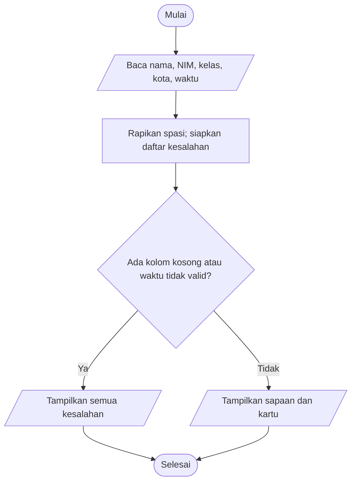

# Bab 1 — Algoritma dan Program Pertama

## Cakupan dan hubungan materi

Bab ini mengubah masalah sehari-hari menjadi kontrak input–proses–output (IPO), lalu menjalankannya sebagai program Python. Ini menjadi dasar untuk representasi algoritma yang lebih terstruktur pada Bab 2. Contoh di bab ini mengasumsikan input angka sudah dapat dikonversi; program biaya di bawah menangani input nonangka agar kegagalan tersebut terlihat jelas.

## Jawaban latihan konsep dan diskusi

1. **Tiga spasi bukan nama yang sah.** `strip()` mengubah `"   "` menjadi teks kosong, sehingga kartu/profil ditolak. `" Siti Aminah "` menjadi `"Siti Aminah"` dan sah. Mengganti input pertama dengan nama itu mengubah hasil dari penolakan menjadi penerimaan.
2. **Kode pos `00123` bertipe `str`, jumlah peserta `23` bertipe `int`.** Kode pos adalah identitas dan nol depannya bermakna; jumlah peserta dipakai dalam aritmetika. Jika `00123` dijadikan angka, nol depannya hilang.
3. **Prodi kosong harus diperiksa sebelum profil dicetak.** Misalnya nama `Rani` dan prodi `""` menghasilkan penolakan, bukan profil setengah lengkap; mengganti prodi menjadi `TI` menghasilkan profil. Langkah pemeriksaan bergantung pada hasil pembacaan dan normalisasi input.
4. **Bukti versi kode yang diuji:** simpan berkas dengan nama yang tepat, jalankan `python nama_berkas.py` dari folder Bab 1, periksa prompt/hasil unik, lalu ubah satu input dan jalankan ulang. Contoh `" Rani "` menghasilkan nama ternormalisasi `Rani`; `"Siti Aminah"` mempertahankan spasi tengah.

Pada diskusi penerapan, aturan yang tetap adalah memangkas spasi tepi, memeriksa semua kolom wajib, dan tidak mengubah NIM menjadi angka. Nilai yang berubah mengikuti input; hasil yang berbeda karena input berbeda adalah wajar, sedangkan kartu yang tercetak saat kolom wajib kosong adalah pelanggaran kontrak.

## Praktikum dan spesifikasi

### A. Kartu peserta (contoh inti, praktikum, tantangan 1–5, studi kasus)

**Tujuan/pengguna:** panitia membuat kartu peserta kegiatan kampus. **Input:** nama, NIM, kelas, kota, dan pilihan sapaan `pagi`/`sore`, semuanya teks. **Proses:** rapikan spasi tepi; ubah kelas ke huruf kapital; kumpulkan semua kolom yang kosong sekaligus; terbitkan kartu hanya bila data lengkap dan sapaan valid. **Output:** sapaan dan kartu yang memuat nama, NIM, kelas, kota. NIM disimpan sebagai teks sehingga `00125` tidak berubah.

Kontrak versi awal contoh kartu meminta nama, NIM, dan kelas. Versi studi kasus menambahkan kota dan sapaan. Dengan input sama `Siti Aminah / 00125 / A`, versi awal dapat menerbitkan kartu; versi baru menolak karena kota belum diisi. Setelah kota dan sapaan ditambahkan, isi identitas yang sudah valid tetap sama (uji regresi).

**Pseudocode**

```text
MULAI
BACA nama, NIM, kelas, kota, waktu
RAPIKAN spasi tepi semua input
DAFTAR kesalahan = semua kolom kosong
JIKA waktu bukan "pagi" atau "sore", tambahkan kesalahan waktu
JIKA daftar kesalahan tidak kosong
    TULIS semua kesalahan
SELAIN ITU
    TULIS sapaan sesuai waktu
    TULIS kartu berisi nama, NIM, kelas, kota
SELESAI
```

**Dry run normal:** `nama=" Siti Aminah "`, `NIM="00125"`, `kelas="a"`, `kota="Bandung"`, `waktu="pagi"` → normalisasi memberi `Siti Aminah`, `00125`, `A`, `Bandung`, `pagi` → semua valid → kartu diterbitkan dan NIM tetap `00125`.

**Dry run batas/penolakan:** nama tiga spasi, NIM kosong, kelas `A`, kota kosong, waktu `sore` → tiga kolom dilaporkan sekaligus; tidak ada kartu/sapaan sukses. Tidak ada data identitas yang diubah sebelum validasi selesai.

Flowchart (teks): `Mulai → baca lima input → rapikan → keputusan: ada kolom kosong / sapaan tidak valid? — Ya → tampilkan semua kesalahan → Selesai; Tidak → tampilkan sapaan dan kartu → Selesai`.



**Peta langkah kode:** `profil.py` membaca dua input, memangkas spasi tepi, memeriksa keduanya tidak kosong, lalu menampilkan sapaan/profil atau pesan penolakan. `kartu_praktikum.py` melakukan pola yang sama untuk nama/NIM/kelas, dengan kelas dibuat kapital dan NIM tetap teks. `kartu_peserta.py` memperluas kontrak menjadi empat kolom dan sapaan waktu; semua kesalahan dikumpulkan sebelum kartu ditampilkan.

**Contoh hasil eksekusi:** `profil.py` dengan `Rani` dan `Teknologi Informasi` menampilkan `Halo, Rani!` serta `Profil: Rani | Teknologi Informasi`. `kartu_praktikum.py` dengan `Siti Aminah / 00125 / a` menampilkan kartu dengan NIM `00125` dan kelas `A`. Uji nama kosong/spasi, NIM kosong, dan kelas kosong menghasilkan pesan untuk kolom terkait dan tidak mencetak kartu.

### B. Tiga peserta (tantangan 3)

Untuk menghindari menyalin blok kode tiga kali, `pendaftaran_tiga_peserta.py` memakai perulangan `for` yang menjalankan proses untuk tepat tiga peserta. Data tiap peserta ditangani sebagai satu rangkaian input; kegagalan satu peserta ditampilkan tanpa mengubah aturan peserta berikutnya. Perulangan menjadi kebutuhan karena langkah baca–validasi–tampil yang sama dijalankan berulang.

### C. Biaya kegiatan (contoh 3 dan tantangan 6)

Biaya tetap Rp50.000 dan konsumsi Rp12.000 per peserta. Untuk 5 peserta: konsumsi `5 × 12.000 = Rp60.000`, total `50.000 + 60.000 = Rp110.000`. Nilai batas 1 peserta menghasilkan Rp62.000. Nilai 0 dan -2 ditolak sebelum hitung; input `abc` juga ditolak sebagai bukan bilangan bulat. Program ada di `biaya_kegiatan.py`.

Output aktual program biaya untuk input `5` adalah:

```text
Peserta: 5
Biaya tetap: Rp50000
Konsumsi: Rp60000
Total rencana: Rp110000
```

Urutan program: tetapkan konstanta tarif → baca dan konversi jumlah peserta → tolak jika bukan integer/positif → hitung konsumsi → jumlahkan biaya tetap → tampilkan hasil.

## Tabel uji dan hasil yang diharapkan

| Kasus | Input | Hasil |
|---|---|---|
| Kartu normal | `Siti Aminah`, `00125`, `a`, `Bandung`, `pagi` | Kartu terbit; NIM `00125`, kelas `A` |
| Nama spasi | nama `"   "` | Kesalahan menyebut Nama; tidak ada kartu |
| Semua kolom identitas kosong | nama/NIM/kota kosong, kelas `A` | Semua kolom yang kosong disebut sekaligus |
| Regresi nama dua kata | `Siti Aminah` | Spasi tengah dipertahankan |
| Regresi kota dua kata | `Kota Baru` | Spasi tengah dipertahankan |
| Sapaan tidak dikenal | `malam` | Sapaan ditolak; kartu tidak diterbitkan |
| Biaya normal | 5 peserta | Konsumsi 60000; total 110000 |
| Batas minimum | 1 peserta | Total 62000 |
| Penolakan | 0 atau -2 | Ditolak; tidak ada total |
| Input bukan integer | `abc` | Pesan input harus bilangan bulat |

Tantangan adaptasi kartu mengubah kontrak secara eksplisit dengan menambahkan kota sebagai kolom wajib. Normalisasi tidak menghilangkan spasi tengah atau nol depan. Untuk uji kasus batas biaya, 1 peserta masih positif dan diterima; uji penolakan tambahan `abc` tidak menghasilkan biaya.

## Evaluasi formatif dan refleksi

1. **Algoritma** adalah langkah terurut yang menyelesaikan kelas masalah; **program** adalah penerapan algoritma dalam bahasa yang bisa dijalankan komputer.
2. NIM bukan `int` karena bukan besaran untuk dihitung dan nol di depan merupakan bagian dari identitas.
3. `strip()` membuang spasi di awal/akhir teks, bukan spasi di tengah.
4. Profil/kartu dicetak setelah seluruh input wajib dinormalisasi dan lolos validasi.
5. Untuk program biaya, batas 1 peserta menghasilkan konsumsi Rp12.000 dan total Rp62.000. Kondisi `peserta <= 0` menentukan apakah program menolak.
6. Input nonangka seperti `abc` menyebabkan konversi `int` gagal. Program menangkap `ValueError`, memberi pesan, dan tidak menghitung/menampilkan total. Hal ini dibuktikan dalam pengujian fungsi dan uji input.
7. Program sapaan dan biaya sama-sama membaca input, memprosesnya, lalu menghasilkan output. Kartu memakai validasi kelengkapan teks; biaya memakai validasi bilangan dan aritmetika.
8. Kesalahan yang mudah terjadi adalah mengubah NIM menjadi angka atau hanya memeriksa satu kolom. Uji `00125` serta input dengan beberapa kolom kosong dapat mengungkapnya.
9. Dipahami: kontrak IPO dan tipe data memengaruhi hasil (NIM harus teks). Perlu dipelajari: perulangan/struktur data untuk menyimpan kumpulan peserta; contoh konkretnya adalah mengulang pendaftaran tiga peserta.

**Hubungan dan keterbatasan:** Bab 1 menggunakan spesifikasi dan urutan langkah sebagai dasar Bab 2 yang memvisualisasikan alur sebagai flowchart/pseudocode. Contoh biaya terbatas pada bilangan bulat positif dan tidak mencakup mata uang pecahan atau data peserta tersimpan permanen.

## Menjalankan dan memverifikasi

Dari folder ini jalankan:

```powershell
python profil.py
python kartu_praktikum.py
python kartu_peserta.py
python pendaftaran_tiga_peserta.py
python biaya_kegiatan.py
python -m unittest -v
```

Tabel di atas adalah prediksi; output uji aktual diverifikasi dengan suite `unittest`. Bantuan penyusunan kode dan penjelasan berasal dari asisten; verifikasi dilakukan dengan menjalankan tes pada folder ini.
