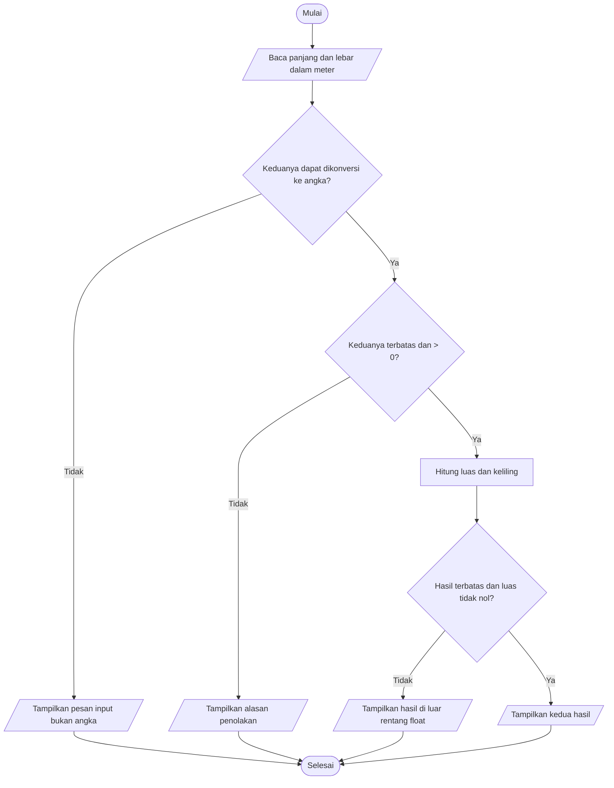
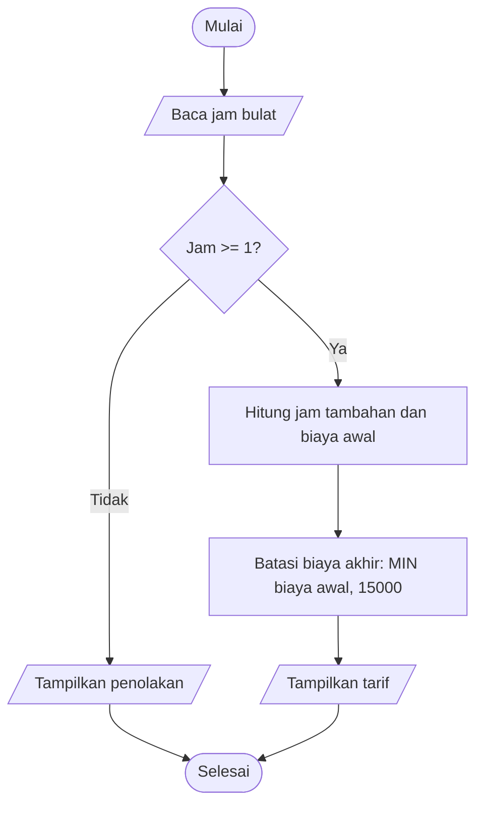

# Bab 2 — Narasi, Flowchart, dan Pseudocode

## Cakupan dan hubungan materi

Bab 2 menyajikan algoritma yang sama sebagai narasi, pseudocode, flowchart, lalu program. Ini meneruskan kontrak IPO, validasi, dan penelusuran pada Bab 1. Simbol flowchart: oval = mulai/selesai, jajar genjang = input/output, persegi panjang = proses, belah ketupat = keputusan; setiap cabang keputusan diberi label dan berakhir jelas.

## Jawaban latihan konsep dan diskusi

1. **Tarif parkir:** satu jam = Rp3.000; tiga jam = `3.000 + (3−1)×2.000 = Rp7.000`. Mengganti tiga jam menjadi satu jam mengubah tambahan dari 2 jam menjadi 0, aturan tetap.
2. **Output tidak boleh langsung mengikuti mulai untuk menampilkan luas.** Luas memerlukan panjang dan lebar yang dibaca lebih dahulu, lalu diuji positif dan dihitung. Contoh 5×3 memberi 15; mengganti lebar menjadi 0 harus memilih jalur penolakan, bukan mencetak luas 0.
3. **Prasyarat luas selain sisi positif:** kedua input harus berupa bilangan yang dapat dikonversi ke `float` dan menggunakan satuan yang sama. Contoh 5 m dan 30 cm perlu normalisasi 30 cm menjadi 0,30 m sebelum menghasilkan 1,50 m²; mengubah lebar menjadi 3 m mengubah luas menjadi 15 m².
4. **Pseudocode** adalah uraian algoritma terstruktur yang tidak terikat sintaks bahasa. Keputusan memiliki jalur Ya/Tidak karena valid dan tidak valid harus memiliki hasil yang berbeda dan dapat ditelusuri. Untuk menguji kesetaraan, jalankan input yang sama pada narasi, pseudocode, flowchart, serta program dan bandingkan cabang serta output-nya.
5. **Penelusuran pertukaran:** `a=merah`, `b=biru` → `sementara=a` menyimpan merah → `a=b` memberi biru → `b=sementara` memberi merah. Jika input `teh/teh`, nilai tetap sama. `a=b; b=a` salah karena merah sudah hilang.

Dalam diskusi kasus luas, perubahan panjang/lebar mengubah hasil perkalian hanya jika kedua sisi valid; aturan validasi tetap. Pada parkir, biaya bergantung pada jam, tetapi tarif pertama tetap Rp3.000 dan penambahan selalu Rp2.000 per jam berikutnya. Pada pertukaran, isi sementara bergantung pada nilai awal `a`; urutan penugasan tidak boleh berubah.

## Tugas representasi, praktikum, dan tantangan

### A. Luas dan keliling persegi panjang (contoh 1, praktikum, tantangan 1–3)

**Kontrak:** panjang dan lebar harus angka nyata yang dapat diwakili `float`, terbatas (bukan `NaN`/tak hingga), positif, dan memakai satuan yang sama. Hasil luas dan keliling juga harus berada dalam rentang `float`; luas yang menjadi nol karena underflow ditolak. Input nonangka, sisi nol/negatif, serta hasil di luar rentang tidak menghasilkan angka sukses.

**Narasi:** baca panjang dan lebar dalam meter; periksa keduanya angka terbatas dan positif. Jika tidak, tolak tanpa menghitung. Jika valid, hitung luas `p×l` dan keliling `2×(p+l)`. Periksa hasil perhitungan juga terbatas dan luas tidak nol akibat underflow, kemudian tampilkan keduanya. Contoh masukan 5 dan 3 menghasilkan 15,00 m² serta 16,00 m.

**Pseudocode**

```text
MULAI
MASUKKAN teks panjang dan lebar
COBA konversi keduanya menjadi float
JIKA konversi gagal
    TULIS pesan bahwa input harus angka
SELAIN ITU
    JIKA salah satu tidak terbatas ATAU <= 0
        TULIS alasan penolakan
    SELAIN ITU
        luas <- panjang * lebar
        keliling <- 2 * (panjang + lebar)
        JIKA hasil tidak terbatas ATAU luas = 0 karena underflow
            TULIS hasil di luar rentang float
        SELAIN ITU
            TULIS luas dan keliling
SELESAI
```

**Flowchart (teks):** `Mulai → baca teks → konversi angka? — Tidak → pesan format → Selesai; Ya → angka terbatas dan kedua sisi > 0? — Tidak → alasan penolakan → Selesai; Ya → hitung → hasil terbatas dan luas tidak nol? — Tidak → pesan rentang → Selesai; Ya → tampilkan → Selesai`.



Peta langkah: input dibaca sekali untuk masing-masing sisi; parsing dan validasi terjadi sebelum operasi; hanya jalur valid menghitung dan menampilkan hasil. Setelah operasi, program memeriksa overflow/underflow agar `inf` atau luas nol akibat underflow tidak dilaporkan sebagai hasil sukses. Contoh input 5 dan 3 menghasilkan `Luas = 15.00 m2` dan `Keliling = 16.00 m`.

Input 2,5 m dan 4 m menghasilkan luas 10,00 m² dan keliling 13,00 m. Untuk tantangan konversi, helper `hitung_geometri_dengan_panjang_cm(250, 4)` membagi 250 cm dengan 100, lalu memanggil perhitungan utama dengan 2,5 m dan 4 m; hasilnya luas 10 m² dan keliling 13 m. Normalisasi satuan harus dilakukan sebelum mengalikan.

### B. Tarif parkir harian (contoh 2, praktikum, tantangan 4–5, studi kasus mandiri)

**Kontrak versi awal:** input jam bulat minimal 1; biaya awal `3.000 + (jam−1)×2.000`. **Pengembangan:** setelah biaya awal dihitung, batasi tarif maksimal Rp15.000: `biaya = min(biaya_awal, 15.000)`. Jam 0/negatif ditolak. Tidak ada pembulatan durasi pecahan karena spesifikasi meminta jam bulat.

**Narasi:** baca jam bulat; tolak jika kurang dari satu; hitung jumlah jam tambahan, biaya awal, lalu terapkan batas maksimum harian; tampilkan jam tambahan, biaya awal, dan biaya akhir.

**Pseudocode**

```text
MULAI
BACA jam
JIKA jam < 1
    TULIS "Durasi minimal satu jam."
SELAIN ITU
    jam_tambahan <- jam - 1
    biaya_awal <- 3000 + jam_tambahan * 2000
    biaya_akhir <- MIN(biaya_awal, 15000)
    TULIS jam_tambahan, biaya_awal, biaya_akhir
SELESAI
```

**Flowchart (teks):** `Mulai → input jam → keputusan: jam >= 1? — Tidak → pesan penolakan → Selesai; Ya → hitung jam tambahan → hitung biaya awal → biaya akhir = MIN(biaya awal, 15000) → tampilkan → Selesai`.



Untuk 3 jam, biaya awal Rp7.000 sehingga aturan baru tidak mengubah hasil (regresi). Untuk 8 jam, biaya awal Rp17.000 menjadi Rp15.000 (hasil berubah karena batas harian). Pada 7 jam, biaya tepat Rp15.000. Tarif pertama tidak dikenai tambahan kedua kali.

Contoh input 3 menghasilkan jam tambahan `2`, biaya awal `Rp7000`, dan tarif akhir `Rp7000`. Baris keputusan `jam < 1` mengarahkan input tidak valid langsung ke penolakan; hitung jam tambahan/biaya hanya dijalankan pada cabang valid.

### C. Menukar dua nilai dengan variabel bantu (contoh 3 dan tantangan 6)

Variabel `sementara` menyimpan nilai lama `a` sebelum `a` ditimpa. Dry run `merah/biru`: keadaan awal `(merah,biru,–)`; setelah simpan `(merah,biru,merah)`; setelah `a=b` `(biru,biru,merah)`; setelah `b=sementara` `(biru,merah,merah)`. Input identik `teh/teh` tetap `teh/teh`; input kosong/`isi` menjadi `isi`/kosong, sesuai latihan teks. Program menggunakan variabel bantu, bukan operasi aritmetika.

Pengujian penolakan tambahan: `None` bukan teks masukan yang dapat diberikan melalui prompt, sehingga helper menolaknya sebagai pelanggaran tipe; string kosong tetap valid agar kasus buku “A kosong dan B isi” menghasilkan pertukaran yang benar.

## Pelaksanaan lengkap praktikum dan tantangan

### Praktikum terbimbing: bukti langkah 1–8

1. **Narasi dan satuan:** input adalah durasi parkir dalam jam bulat; tarif menggunakan rupiah. Jam harus minimal satu.
2. **Flowchart:** mulai → baca jam → keputusan `jam >= 1?`; cabang Tidak menampilkan penolakan lalu selesai, cabang Ya menghitung tambahan dan biaya awal, menerapkan batas harian, menampilkan hasil, lalu selesai. Diagram Mermaid di bagian tarif adalah flowchart final.
3. **Dry run sebelum kode:** 5 jam → 4 tambahan → biaya awal/akhir Rp11.000; 3 jam → 2 tambahan → Rp7.000; 0 jam → kondisi gagal, tidak ada biaya.
4. **Cocokkan cabang:** `if jam < 1` harus sama dengan cabang Tidak pada diagram; rumus biaya hanya berada di cabang valid; `min()` membatasi setelah biaya awal dihitung.
5. **Kontrak:** jam bulat positif diterima; jam nol/negatif dan tipe noninteger ditolak. Versi dasar menghitung tarif tanpa maksimum; fitur pengembangan menambahkan maksimum Rp15.000.
6. **Dry run batas:** 1 jam → 0 jam tambahan dan Rp3.000. Pada pengembangan, 7 jam menghasilkan tepat Rp15.000; 8 jam menghasilkan biaya awal Rp17.000 lalu tarif akhir Rp15.000.
7. **Implementasi bertahap:** `hitung_tarif()` memvalidasi dan menghitung jam tambahan serta biaya awal, lalu menerapkan batas. Fungsi terpisah memudahkan pengujian tanpa input terminal.
8. **Penolakan/regresi:** tes jam 0/-1 memastikan tidak ada tarif; tes 3 jam memastikan hasil lama Rp7.000 tidak berubah; tes 8 jam membuktikan aturan maksimum baru berlaku.

### Hasil setiap tantangan bertingkat

| Tantangan | Implementasi dan pembuktian |
|---|---|
| 1. Pseudocode keliling | Rumus: `keliling <- 2 * (panjang + lebar)`. Contoh 5 m dan 3 m menghasilkan 16 m; input dibaca dan divalidasi sebelum rumus. |
| 2. Luas dan keliling | `luas_dan_keliling.py` membaca panjang serta lebar satu kali, lalu menghasilkan luas 15 m² dan keliling 16 m untuk 5×3. Tes memeriksa kedua nilai. |
| 3. Sentimeter ke meter | Helper `hitung_geometri_dengan_panjang_cm(250, 4)` mengubah 250 cm menjadi 2,5 m sebelum menghitung; hasil 10 m² dan 13 m. Nilai nol, tipe salah, dan nilai tidak terbatas ditolak. |
| 4. Maksimum tarif | Biaya dihitung dahulu, lalu `min(biaya_awal, 15000)`. 7 jam tepat Rp15.000; 8 jam berubah dari Rp17.000 menjadi Rp15.000; 3 jam tetap Rp7.000. Narasi, pseudocode, dan flowchart mencerminkan urutan ini. |
| 5. Aturan tarif bertingkat | Jam bulat minimal 1; `tambahan = jam - 1`; `biaya = 3000 + tambahan * 2000`. Perbandingan input 3 jam menunjukkan Rp7.000; input 1 jam (pembeda) harus Rp3.000, bukan Rp5.000. |
| 6. Pertukaran teks | `tukar("merah", "biru")` menghasilkan A=`biru`, B=`merah`; keadaan sementara berurutan `–`, `merah`, `merah`. Uji tambahan tipe salah (`None`) ditolak dan helper tidak mengembalikan hasil sukses. |

## Tabel uji dan hasil yang diharapkan

| Kasus | Input | Hasil |
|---|---|---|
| Luas normal | 5 m, 3 m | Luas 15,00 m²; keliling 16,00 m |
| Pecahan | 2,5 m, 4 m | Luas 10,00 m²; keliling 13,00 m |
| Batas sisi nol | 0, 3 | Ditolak: sisi harus positif |
| Sisi negatif | -2, 4 | Ditolak: sisi harus positif |
| Uji satuan | 250 cm, 4 m | Normalisasi 2,5 m; luas 10 m² |
| Tampilan presisi | 0,05 m, 0,05 m | Luas matematis 0,0025 m²; format dua desimal menampilkan 0.00 m2 |
| Input bukan angka | `abc`, 3 | Pesan input harus berupa angka; tanpa hasil |
| Overflow luas | `1e308`, `1e308` | Ditolak; tanpa `inf` atau keluaran sukses |
| Overflow keliling | `1e308`, 1 | Ditolak; tanpa `inf` atau keluaran sukses |
| Underflow luas | `1e-200`, `1e-200` | Ditolak; tidak melaporkan luas `0.0` |
| Parkir minimum | 1 jam | Tambahan 0; tarif akhir Rp3.000 |
| Parkir normal/regresi | 3 jam | Biaya awal/akhir Rp7.000 |
| Batas tarif | 7 jam | Biaya Rp15.000, persis batas |
| Pembatas baru | 8 jam | Biaya awal Rp17.000; tarif akhir Rp15.000 |
| Penolakan | 0 atau -1 jam | Ditolak; tidak menghitung tarif |
| Tukar berbeda | merah, biru | A biru; B merah |
| Tukar sama | teh, teh | Keduanya teh |
| Tukar nilai kosong | kosong, isi | A isi; B kosong |

Uji penolakan input teks nonangka menghindari keluaran luas/tarif palsu. Input sisi nonangka/nonhingga dan jam noninteger dilaporkan dengan pesan yang jelas; batas validasi ini melengkapi kontrak dasar.

## Audit dan perbaikan geometri

Audit kode menemukan bahwa pemeriksaan sisi positif saja belum cukup untuk semua `float`. Angka sisi `1e308` terbatas dan positif, tetapi mengalikan keduanya menghasilkan `inf`; sisi `1e308` dan `1` membuat keliling overflow. Dua sisi `1e-200` menghasilkan luas `0.0` akibat underflow. Versi sebelumnya mengembalikan hasil itu seolah sah. Fungsi sekarang memeriksa tipe, nilai input, dan hasil hitung, lalu mengangkat `ValueError` dengan penjelasan bila hasil tidak dapat diwakili. `main()` menampilkan pesan tersebut dan tidak mencetak luas/keliling palsu.

### Tutorial membaca `luas_dan_keliling.py`

1. `from math import isfinite` menyediakan pemeriksaan bahwa bilangan bukan `NaN` atau tak hingga.
2. `hitung_geometri(panjang, lebar)` adalah fungsi perhitungan yang dapat diuji sendiri tanpa menjalankan prompt terminal. Ia menolak boolean/nonangka dengan `TypeError`, karena `bool` di Python juga merupakan turunan `int`.
3. Nilai integer yang valid diubah menjadi `float`. Integer yang terlalu besar untuk konversi ditolak. Input `NaN`, `inf`, nol, dan nilai negatif juga ditolak sebelum perhitungan.
4. Rumusnya `luas = panjang * lebar` dan `keliling = 2 * (panjang + lebar)`. Pemeriksaan setelah rumus menghalangi overflow (`inf`) dan underflow luas menjadi nol.
5. `hitung_geometri_dengan_panjang_cm()` adalah variasi tantangan satuan: validasi tipe, konversi sentimeter ke meter (`/ 100`), lalu memakai fungsi utama supaya aturan dan validasi tidak diduplikasi.
6. `main()` meminta input teks dan mengubahnya dengan `float()`. `ValueError` dari input teks yang bukan angka ditangani terpisah dari `ValueError` validasi/perhitungan. Untuk sukses saja hasil dicetak dengan dua angka desimal.
7. Blok `if __name__ == "__main__":` membuat program interaktif berjalan saat dieksekusi langsung, tetapi tidak menjalankan prompt ketika modul diimpor oleh tes.

### Membaca tiga program lain

- `tarif_parkir.py`: konstanta menyimpan tarif dasar, tarif tambahan, dan batas harian. Fungsi `hitung_tarif()` mensyaratkan integer jam (boolean ditolak) dan jam minimal satu, menghitung jam tambahan `jam - 1`, biaya awal, lalu menerapkan batas dengan `min()`. Biaya awal ikut ditampilkan agar dampak batas dapat ditelusuri.
- `tukar_nilai.py`: `sementara = a` menyimpan nilai A sebelum ditimpa. Lalu `a = b`, `b = sementara`; fungsi mengembalikan nilai baru dan nilai sementara untuk pembuktian dry run. String kosong tetap sah sebagai isi teks, tetapi nilai nonteks ditolak.
- `test_bab2.py`: `unittest` menguji hasil normal, pecahan, konversi satuan, batas, input invalid, overflow/underflow, serta pertukaran. Tes CLI memastikan kasus overflow menghasilkan pesan dan tidak mencetak hasil sukses.

## Evaluasi formatif dan refleksi

1. Pseudocode menjelaskan urutan dan keputusan dengan sintaks bebas bahasa pemrograman.
2. Dua jalur keputusan membedakan hasil ketika syarat terpenuhi dan tidak terpenuhi, sehingga jalur invalid tidak melewati proses yang tidak sah.
3. Variabel sementara menjaga nilai lama agar tidak hilang ketika variabel lain ditimpa.
4. Jalankan kasus input identik pada narasi, pseudocode, flowchart, dan program; cek rumus, kondisi, label cabang, dan output.
5. Pada luas, `0` dan `3` harus memilih cabang invalid karena kondisi sisi nol/negatif atau tidak terbatas.
6. Input `"abc"` bukan angka; konversi gagal, program menampilkan pesan input dan tidak menghitung luas. Input angka sangat besar dapat lolos parsing sebagai float terbatas, tetapi hasil perkalian/penjumlahan dapat overflow. Pemeriksaan hasil menghindari output `inf`.
7. Contoh luas dan tarif sama-sama menguji prasyarat sebelum menghitung. Luas memerlukan dua besaran positif dan perkalian; tarif menggunakan jam minimal satu serta tarif dasar ditambah tarif jam tambahan.
8. Bug paling rawan pada tarif adalah memakai `jam * 2000` untuk biaya tambahan, yang menghitung jam pertama dua kali. Uji 1 jam akan segera mengungkapnya karena biaya benar Rp3.000, bukan Rp5.000.
9. Dipahami: simbol flowchart dan keputusan harus sesuai dengan kode; perlu dipelajari: konversi/normalisasi berbagai satuan untuk masukan yang beragam. Contoh: 250 cm harus menjadi 2,5 m sebelum dihitung.

**Hubungan dan keterbatasan:** Bab 2 menerjemahkan kontrak dan urutan algoritma Bab 1 menjadi representasi yang dapat diperiksa sebelum implementasi. Model tarif adalah latihan (bukan kebijakan parkir nyata), hanya menerima jam bulat, dan batas Rp15.000 berlaku per hari. Input luas mengharuskan satuan sama dan menerima angka terbatas.

Format `.2f` memang membulatkan hasil ke dua angka desimal untuk mengikuti contoh materi. Akibatnya, luas positif yang lebih kecil dari kira-kira `0,005 m²` dapat terlihat sebagai `0.00 m2`; nilai perhitungan di dalam fungsi tetap lebih presisi. Jika aplikasi perlu melaporkan ukuran sangat kecil, ubah format tampilan atau tampilkan lebih banyak digit. Model parkir juga menganggap satu input durasi sebagai satu transaksi yang dikenai satu batas maksimum Rp15.000; aturan lintas beberapa hari tidak didefinisikan dalam soal.

## Menjalankan dan memverifikasi

Buka PowerShell, pindah ke folder Bab 2, lalu jalankan program:

```powershell
Set-Location 'D:\MR.4NONY\TUGTIKUM\Bab 2'
python luas_dan_keliling.py
python tarif_parkir.py
python tukar_nilai.py
```

Contoh input `5` kemudian `3` menampilkan luas `15.00 m2` dan keliling `16.00 m`. Untuk melihat penolakan overflow, masukkan `1e308` untuk kedua sisi. Untuk tes otomatis semua program:

```powershell
python -m unittest -v
```

Suite menguji perhitungan normal, batas sisi, konversi 250 cm, overflow/underflow, tarif parkir, pertukaran, dan jalur pesan CLI. Uji satuan bukan sekadar hitungan manual; helper konversi diuji otomatis. Bantuan penyusunan kode dan penjelasan berasal dari asisten; verifikasi dilakukan dengan menjalankan tes pada folder ini.
