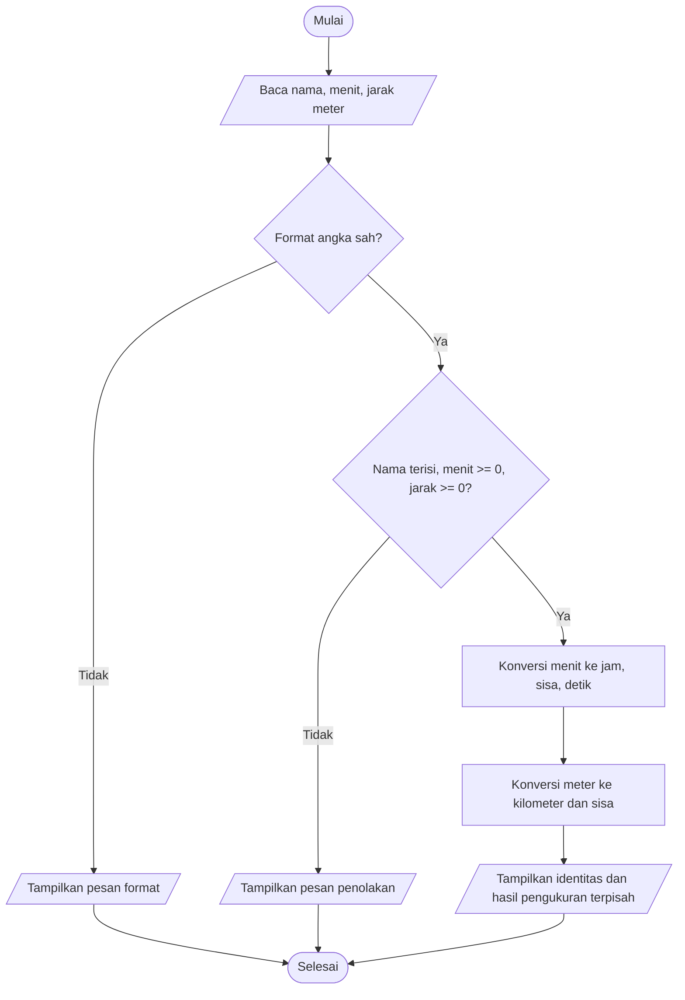

# Bab 3 — Variabel, Tipe Data, dan Konversi

## Capaian dan hubungan dengan Bab 1–2

Bab 1 memperkenalkan kontrak input–proses–output dan Bab 2 melatih urutan serta cabang algoritma. Bab 3 menggunakan keduanya untuk memilih tipe data, mengubah input teks menjadi angka sebelum aritmetika, mengonversi satuan dengan benar, dan menampilkan nilai setelah perhitungan.

Analogi materi: jumlah apel cocok sebagai integer, volume dapat berupa pecahan, nama adalah teks, dan status adalah Boolean. Tipe menentukan operasi bermakna. Program bab ini menerapkan aturan tersebut dalam suhu, durasi, jarak, dan kecepatan.

## Jawaban pertanyaan pembuka dan latihan konsep

1. **Apa tipe keluaran `input()`?** `str` (teks), selalu, termasuk ketika pengguna mengetik angka. Contoh, `input()` yang menerima `12` memberi `"12"`; untuk menjumlahkan sebagai bilangan, konversikan dengan `int("12")`. Mengubah input menjadi `12.5` memerlukan `float`.
2. **Apa beda `4` dan `"4"`?** `4` bertipe `int`, sehingga `4 + 3` menghasilkan `7`; `"4"` bertipe `str`, sehingga `"4" + "3"` menghasilkan `"43"`. Jika input `"4"` dikonversi dengan `int`, operasi berubah menjadi penjumlahan numerik. NIM atau kode pos tetap teks karena nol awal dan identitas harus dipertahankan.
3. **Bagaimana membaca status aktif dari jawaban “ya”?** Jangan memakai `bool("tidak")`, sebab setiap string tidak kosong bernilai `True`. Normalisasikan teks dan bandingkan secara eksplisit, misalnya `jawaban.strip().lower() in {"ya", "y"}`. `" ya "` berarti aktif; menggantinya dengan `"tidak"` berarti tidak aktif.
4. **Uraikan 59, 60, dan 61 menit:** `59 // 60 = 0`, `59 % 60 = 59`; `60 // 60 = 1`, `60 % 60 = 0`; `61 // 60 = 1`, `61 % 60 = 1`. Pembagian bulat menghitung jam utuh dan modulo memberi menit sisa. Jika `61` diubah menjadi `135`, hasilnya `2 jam 15 menit`.
5. **Mengapa waktu nol ditolak pada hitung kecepatan?** Rumusnya `jarak / waktu_jam`, sehingga waktu nol menyebabkan pembagian dengan nol dan tidak mendefinisikan kecepatan. Contoh 10 km dalam 0 menit ditolak; 10 km dalam 30 menit menghasilkan 20 km/jam. Jarak nol tetap sah bila waktunya positif.

### Diskusi ketergantungan nilai dan aturan

- **Durasi:** `jam` dan `sisa` baru dapat dihitung setelah nilai `menit` dibaca dan divalidasi. Jika menit berubah, hasil jam/sisa/detik berubah; aturan `// 60`, `% 60`, serta invariant `jam * 60 + sisa == menit` tetap.
- **Suhu:** Fahrenheit dan Kelvin bergantung pada Celsius yang sudah dibaca sebagai angka. Mengubah Celsius mengubah dua hasil, tetapi rumus konversi tetap. Validasi tambahan di program ini menolak suhu di bawah nol mutlak.
- **Kecepatan:** `waktu_jam` bergantung pada `waktu_menit / 60`, lalu kecepatan bergantung pada jarak dan waktu yang sudah dinormalisasi. Mengubah waktu mengubah kecepatan; aturan waktu positif dan konversi menit-ke-jam tetap.

Perubahan output karena nilai valid yang berbeda adalah wajar. Menghasilkan kecepatan untuk waktu nol, durasi negatif, atau hasil hitung dari string tanpa konversi melanggar kontrak.

## Spesifikasi, pseudocode, dan diagram alur

### A. Celsius ke Fahrenheit dan Kelvin

**Kontrak:** masukan Celsius berupa angka terbatas dan `C >= -273.15`. Keluaran Fahrenheit `C * 9 / 5 + 32` dan Kelvin `C + 273.15`. Unit ada di nama/prompt/label. Contoh buku mengabaikan validasi nol mutlak; program ini menambahkannya sebagai pengembangan yang diminta tantangan.

**Pseudocode**

```text
MULAI
BACA teks Celsius
COBA ubah menjadi float
JIKA format salah, TULIS pesan input angka
SELAIN ITU JIKA Celsius tidak terbatas ATAU Celsius < -273.15
    TULIS pesan penolakan
SELAIN ITU
    Fahrenheit <- Celsius * 9 / 5 + 32
    Kelvin <- Celsius + 273.15
    TULIS Fahrenheit dan Kelvin
SELESAI
```

Titik uji pembeda: `0 C -> 32 F, 273.15 K`; `100 C -> 212 F, 373.15 K`; `-40 C -> -40 F, 233.15 K`; batas `-273.15 C -> 0 K`; `-273.16 C` ditolak. Nilai Celsius negatif di atas nol mutlak tetap sah.

### B. Menit ke jam, menit sisa, dan detik

**Kontrak:** durasi berupa bilangan bulat menit `>= 0`. `jam = menit // 60`; `sisa = menit % 60`; `detik = menit * 60`. Pemeriksaan balik wajib memenuhi `jam * 60 + sisa == menit`. Format teks desimal seperti `2.5` tidak termasuk bilangan bulat menit.

**Pseudocode**

```text
MULAI
BACA teks menit
COBA ubah menjadi integer
JIKA format salah ATAU menit < 0
    TULIS pesan penolakan
SELAIN ITU
    jam <- menit // 60
    sisa <- menit % 60
    detik <- menit * 60
    TULIS jam, sisa, detik
    TULIS jam * 60 + sisa sebagai pemeriksaan balik
SELESAI
```

Dry run `135`: `135 // 60 = 2`, `135 % 60 = 15`, `135 * 60 = 8100`; rekonstruksi `2 * 60 + 15 = 135`. Batas: 0 menghasilkan `0 jam 0 menit`; 59 menghasilkan `0 jam 59 menit`; 60 menghasilkan `1 jam 0 menit`. Nilai negatif ditolak sebelum perhitungan.

### C. Jarak dan kecepatan rata-rata

**Kontrak:** jarak kilometer adalah angka terbatas `>= 0`; waktu menit adalah angka terbatas `> 0`. Konversi `waktu_jam = waktu_menit / 60` dilakukan sebelum `kecepatan = jarak_km / waktu_jam`. Hasil berunit km/jam. Ini latihan satuan, bukan perkiraan keselamatan perjalanan.

**Pseudocode**

```text
MULAI
BACA jarak_km dan waktu_menit sebagai float
JIKA format salah
    TULIS pesan input angka
SELAIN ITU JIKA salah satu tidak terbatas ATAU jarak_km < 0 ATAU waktu_menit <= 0
    TULIS pesan penolakan
SELAIN ITU
    waktu_jam <- waktu_menit / 60
    JIKA waktu_jam menjadi nol/tidak terbatas ATAU hasil kecepatan tidak terbatas
        TULIS pesan rentang nilai
    SELAIN ITU
        kecepatan <- jarak_km / waktu_jam
        TULIS waktu_jam dan kecepatan
SELESAI
```

Dry run `15 km, 30 menit`: waktu `30 / 60 = 0.5 jam`, kecepatan `15 / 0.5 = 30 km/jam`. Input `0 km, 20 menit` menghasilkan `0 km/jam`. Waktu 0 atau jarak negatif ditolak sebelum pembagian.

### D. Meter ke kilometer dan meter sisa

**Kontrak:** jarak integer meter `>= 0`. `kilometer = meter // 1000`; `sisa_meter = meter % 1000`. Identitas peserta adalah teks terpisah dari besaran hitung.

**Pseudocode**

```text
MULAI
BACA jarak_meter sebagai integer
JIKA format salah ATAU jarak_meter < 0
    TULIS pesan penolakan
SELAIN ITU
    kilometer <- jarak_meter // 1000
    sisa_meter <- jarak_meter % 1000
    TULIS kilometer dan sisa_meter
SELESAI
```

Contoh `2345 m -> 2 km 345 m`; batas `999 m -> 0 km 999 m`, dan `1000 m -> 1 km 0 m`.

### Flowchart studi kasus mandiri



## Jawaban praktikum terbimbing (langkah 1–8)

1. Tabel suhu, mencakup sampel inti dan batas:

   | Celsius | Fahrenheit (`C * 9/5 + 32`) | Kelvin (`C + 273.15`) |
   |---:|---:|---:|
   | -273.15 | -459.67 | 0.00 |
   | -40 | -40.00 | 233.15 |
   | 0 | 32.00 | 273.15 |
   | 25 | 77.00 | 298.15 |
   | 100 | 212.00 | 373.15 |

2. Mengganti `float(input(...))` dengan `input(...)` saja membuat variabel tetap `str`; operasi `celsius * 9 / 5` memunculkan `TypeError` karena teks tidak dapat dibagi float. Untuk satu input yang hanya berupa bilangan bulat, `celsius * 9` dapat tampak seperti pengulangan teks, tetapi `/ 5` tetap gagal. Konversi eksplisit memperjelas tipe.
3. Program baru `konversi_kilometer_ke_meter.py` mengubah kilometer menjadi meter (contoh `1.25 km -> 1250 m`) dalam berkas terpisah. Program `konversi_jarak.py` mengerjakan arah yang berbeda, yaitu meter menjadi kilometer dan sisa meter, untuk studi kasus.
4. **Kesalahan format** terjadi saat input tidak dapat diparse menjadi tipe yang disyaratkan (`"abc"` sebagai float, `"2.5"` sebagai integer). **Kesalahan rumus** terjadi jika input valid dihitung dengan rumus/satuan salah, misalnya membagi km langsung dengan menit lalu memberi label km/jam.
5. Kontrak laboratorium: durasi integer tidak negatif; nama berupa teks tidak kosong pada laporan gabungan; jarak integer meter tidak negatif. Input format salah diberi pesan format, nilai di luar domain diberi pesan penolakan; hasil tidak dicetak pada jalur gagal. Pengembangan tambahan ialah pelaporan identitas bersama durasi dan jarak serta pemeriksaan rentang pecahan.
6. Dry run normal `135 menit, 2345 m` menghasilkan `2 jam 15 menit`, `8100 detik`, rekonstruksi `135`, jarak `2 km 345 m`. Dry run batas `0 menit, 0 m` menghasilkan semua nol tanpa penolakan.
7. Versi terkecil `konversi_durasi.py` menghitung satuan durasi. Berikutnya ditambahkan helper jarak terpisah; `konverter_kegiatan.py` menggabungkan hasil sambil menjaga `nama` terpisah dari angka durasi/jarak.
8. Uji negatif, format noninteger, sisi suhu di bawah nol mutlak, waktu nol, serta jarak negatif dijalankan. Untuk setiap jalur gagal, fungsi melempar error sebelum menghasilkan laporan/kecepatan; tes CLI memastikan pesan ditampilkan dan tidak ada output sukses.

Program konversi kilometer-ke-meter menerima angka terbatas tidak negatif, termasuk pecahan. Misalnya `1.25 km * 1000 = 1250 m`. `0` diterima, nilai negatif dan `NaN`/tak hingga ditolak, sedangkan format teks nonangka dilaporkan oleh CLI. Ini berbeda dari studi kasus meter-ke-kilometer yang memakai pembagian bulat dan modulo untuk memperoleh unit penuh serta sisanya.

## Tantangan bertingkat 1–6

1. **Menit ke detik:** `detik = menit * 60`. Implementasi di `konversi_durasi.py`; uji `135 -> 8100`, `0 -> 0`, dan `-1` ditolak.
2. **Pecah 135 menit:** gunakan `//` dan `%`, bukan `round(135 / 60)`. Hasilnya 2 jam 15 menit; untuk 59 menit, hasil harus 0 jam 59 menit.
3. **Tolak Celsius di bawah -273.15:** fungsi suhu menerima tepat `-273.15` dan menghasilkan 0 K; suhu `-273.16` ditolak. Toleransi pembanding tidak diterapkan ke batas domain: nilai yang benar-benar kurang dari batas tidak sah.
4. **Jarak meter ke kilometer dan sisa:** `2345 // 1000 = 2`, `2345 % 1000 = 345`. Rancangan laporan memiliki `nama` terpisah sebagai identitas dan `menit`/`jarak_meter` sebagai ukuran.
5. **Ubah satu aturan durasi:** kontrak lama contoh hanya menguraikan jam/sisa; versi pengembangan menambahkan total detik dan pemeriksaan balik. Input pembanding `135` tetap menghasilkan `2 jam 15 menit`; versi baru juga menampilkan `8100 detik` serta rekonstruksi `135 menit`.
6. **Buktikan contoh kecepatan:** batas jarak nol `0 km, 20 menit` menghasilkan waktu `1/3 jam` dan kecepatan `0 km/jam`, sah karena jarak boleh nol. Uji penolakan tambahan `10 km, 0 menit` ditolak sebelum pembagian. Contoh normal 15 km/30 menit memberi 30 km/jam.

## Studi kasus mandiri: analisis dan tabel uji

1. **Tujuan/pengguna:** membantu panitia atau peserta mengubah durasi kegiatan dan jarak ke satuan yang mudah dibaca. Input: nama (teks), menit bulat tidak negatif, jarak meter bulat tidak negatif. Output: identitas, jam, menit sisa, detik, pemeriksaan balik, kilometer dan sisa meter.
2. Urutannya: baca input; parse menit dan meter sebagai integer; validasi format/nilai; pecah durasi dengan `// 60` dan `% 60`; hitung detik; pecah jarak dengan `// 1000` dan `% 1000`; tampilkan. Jalur invalid langsung ke pesan dan selesai.
3. `nama` menyimpan identitas teks dan tidak digunakan untuk hitung; `menit` serta `jarak_meter` adalah variabel besaran integer. Nilai hasil baru dibuat setelah input lolos validasi.
4. Trace normal: nama `Rani`, menit `135`, jarak `2345`; `jam=2`, `sisa=15`, `detik=8100`, balik `2*60+15=135`; `km=2`, `sisa_meter=345`.
5. Batas terkecil `0` diterima dan semua hasil nol. Batas pembagian 59/60/61 menghasilkan 0:59, 1:00, dan 1:1. Semua nilai negatif ditolak; batas terbesar tidak ditentukan soal, dan Python integer tidak memiliki overflow ukuran tetap, walau kapasitas memori tetap membatasi masukan yang sangat besar.
6. Versi awal hanya keluaran durasi; versi pengembangan menambah jarak dan identitas peserta. Kasus `135 menit` mempertahankan hasil 2 jam 15 menit, sedangkan output laporan berubah dengan tambahan detik/rekonstruksi/nama dan konversi jarak.

| Kelompok | Input uji | Ekspektasi |
|---|---|---|
| Normal | 135 menit; 2345 m | 2 jam 15 menit; 8100 detik; 2 km 345 m |
| Batas nol | 0 menit; 0 m | Diterima; semua besaran nol |
| Batas jam | 59, 60, 61 menit | 0:59, 1:00, 1:01 |
| Batas kilometer | 999, 1000, 1001 m | 0 km 999 m; 1 km 0 m; 1 km 1 m |
| Penolakan nilai | -1 menit atau -1 m | Ditolak, tidak ada laporan hasil |
| Penolakan format | `2.5` menit atau `abc` meter | Pesan format bilangan bulat |
| Regresi | 135 menit sebelum/sesudah pengembangan | Bagian hasil durasi tetap 2 jam 15 menit |

## Evaluasi formatif dan refleksi

1. `input()` menghasilkan `str`.
2. `/` membagi dan menghasilkan nilai pecahan; `//` membagi lalu mengambil hasil bulat ke bawah. Durasi memakai `//`, bukan pembagian biasa yang dibulatkan.
3. Periksa durasi dengan invariant `jam * 60 + sisa == menit`, `0 <= sisa < 60`, dan `detik == menit * 60`.
4. Tidak. `.2f` hanya mengatur tampilan dua tempat desimal; nilai numerik asli tetap tidak diubah oleh format tersebut.
5. Contoh batas suhu: `-273.15 C` diterima sebagai nol mutlak; kondisi `celsius < CELSIUS_MINIMUM` menentukan penolakan. Perubahan kecil ke `-273.16` mengubah cabang menjadi penolakan.
6. Durasi negatif ditolak sebelum hitung; variabel hasil belum dibuat dan tidak ada laporan sukses. Uji fungsi membuktikan exception, sedangkan uji CLI dapat memeriksa hanya pesan gagal yang tampil.
7. Konverter suhu dan konverter durasi sama-sama membaca teks, mengonversi tipe sebelum hitung, lalu memformat output. Suhu memakai `float` dan rumus skala; durasi memakai `int`, pembagian bulat, dan modulo karena memecah unit utuh.
8. Kesalahan rawan adalah memakai `/` atau `round()` untuk membagi durasi: uji 59 menit dapat menghasilkan jam keliru. Uji batas 59, 60, 61 menangkap kesalahan itu.
9. Dipahami: `//` dan `%` memecah durasi dan dapat diverifikasi dengan rekonstruksi. Perlu dipelajari: presisi floating-point; contoh operasi suhu/kecepatan menghasilkan pecahan yang tampilan dua desimalnya dapat membulat.

**Keterbatasan:** input durasi dan jarak dibatasi bilangan bulat; suhu dan kecepatan memakai `float` biner sehingga presisi desimal tidak selalu eksak. Program hanya menggunakan konversi unit sederhana dan tidak menyimpan data peserta secara permanen.

## Tutorial menjalankan program

Dari PowerShell, pindah ke folder ini:

```powershell
Set-Location 'D:\MR.4NONY\TUGTIKUM\Bab 3'
```

Jalankan program yang diperlukan:

```powershell
python konversi_suhu.py
python konversi_durasi.py
python konversi_jarak.py
python konversi_kilometer_ke_meter.py
python kecepatan_perjalanan.py
python konverter_kegiatan.py
```

Contoh input dan keluaran ringkas:

- Suhu `25` → `77.00 F`, `298.15 K`.
- Durasi `135` → 2 jam 15 menit, 8100 detik, rekonstruksi 135.
- Jarak `2345` → 2 km 345 m.
- Konversi `1.25` km → 1250 meter.
- Kecepatan `15` km dan `30` menit → 0.50 jam, 30.00 km/jam.
- Laporan kegiatan `Rani`, `135` menit, `2345` m menggabungkan hasil tersebut dengan identitas peserta.

Jalankan tes otomatis dari folder Bab 3:

```powershell
python -m unittest -v
```

Suite menguji contoh normal, nilai batas, penolakan, format, invariant rekonstruksi, dan fungsi gabungan. Tabel di atas adalah ekspektasi; hasil otomatis diverifikasi dengan `unittest`. Bantuan penyusunan kode dan penjelasan berasal dari asisten, dan tes dijalankan pada workspace ini.
